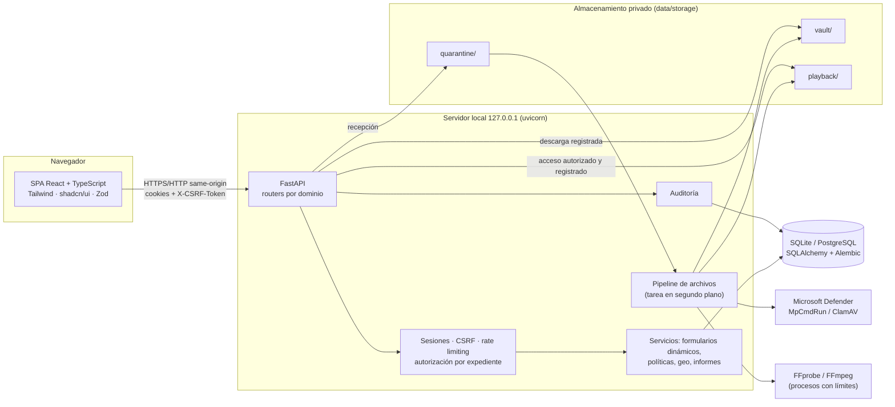
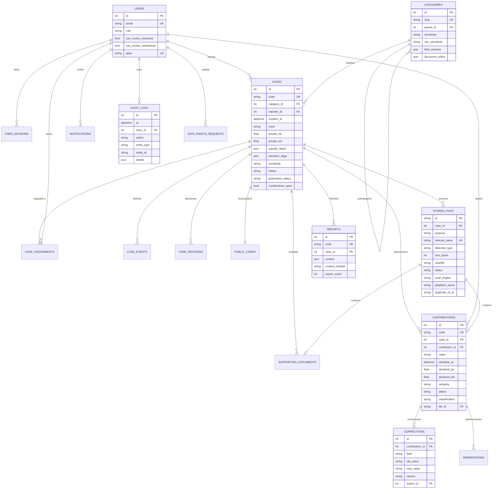
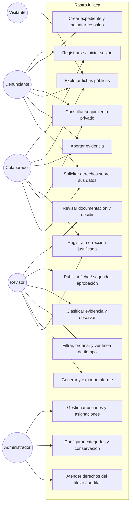

# RastroJuliaca — Documentación académica

**Sistema colaborativo de gestión y revisión de evidencias digitales para incidentes ciudadanos**
Contexto: Juliaca, provincia de San Román, Puno, Perú. Prototipo (MVP) para demostración universitaria.

> Aviso: RastroJuliaca no reemplaza a la Policía Nacional del Perú, no certifica denuncias, no determina
> culpabilidad y no garantiza la resolución de incidentes. El MVP no está autorizado para procesar
> incidentes reales ni declara cumplimiento legal certificado.

---

## 1. Descripción del problema regional

Cuando ocurre un incidente en Juliaca (un robo de vehículo, un accidente de tránsito, la pérdida de un
objeto), los registros potencialmente útiles suelen estar dispersos entre vecinos, comercios y cámaras
particulares. Esas grabaciones y fotografías se comparten de manera informal (mensajería, grupos
vecinales, redes sociales), lo que produce:

- **Dispersión y desorden:** archivos sin asociación clara a un caso, con nombres genéricos y sin datos
  de contexto (hora, lugar, quién lo registró).
- **Exposición de colaboradores y afectados:** la identidad de quien aporta y los datos de la víctima
  circulan sin control.
- **Riesgo de manipulación y pérdida de integridad:** no existe una huella que permita verificar que un
  archivo no cambió desde su recepción.
- **Revisión costosa:** quien revisa debe abrir archivo por archivo, deducir a qué incidente pertenece y
  ordenar manualmente por hora y cercanía.
- **Riesgos de seguridad:** archivos de origen desconocido abiertos sin análisis.

El problema no es la falta de evidencias, sino la falta de un medio **voluntario, ordenado, protegido y
auditable** para reunirlas y revisarlas.

## 2. Objetivo general

Desarrollar un sistema web que permita centralizar voluntariamente, proteger y organizar por expediente
las evidencias digitales aportadas por ciudadanos sobre incidentes, para facilitar su revisión por
operadores autorizados con trazabilidad, minimización de datos y controles de seguridad verificables.

## 3. Objetivos específicos

1. Implementar expedientes multiincidente con categorías, subcategorías y formularios dinámicos validados
   en frontend y backend.
2. Implementar un flujo de revisión documental con aprobación, rechazo y solicitud de correcciones, y una
   publicación moderada de fichas generalizadas.
3. Implementar la recepción segura de aportaciones (cuarentena, antivirus, validación de formato, hash
   SHA-256, detección de duplicados, copias seguras de reproducción y registro de accesos).
4. Implementar herramientas de revisión: clasificación, observaciones, filtros, ordenamiento por cercanía
   geográfica (Haversine) y temporal, línea de tiempo y correcciones sin sobrescritura.
5. Generar informes estructurados exportables (JSON y PDF) con huella de integridad y registro de
   exportación.
6. Aplicar políticas de sensibilidad (GENERAL, RESTRINGIDO, INSTITUCIONAL) con protecciones reforzadas no
   desactivables.
7. Verificar el funcionamiento mediante pruebas automatizadas y preparar un protocolo experimental
   reproducible para medir la mejora en la gestión de evidencias.

## 4. Alcance

**Incluye:** registro y autenticación; cuatro roles; expedientes de 11 categorías con subcategorías;
documentación de respaldo; revisión y publicación moderada; aportaciones de video, fotografía, documento
y texto; validación de archivos; panel del revisor; línea de tiempo; informes; panel administrativo
(usuarios, asignaciones, categorías, auditoría, conservación, derechos del titular); datos ficticios de
demostración; pruebas automatizadas; scripts de instalación para Windows 11.

**No incluye:** reconocimiento facial o de placas; reconstrucción automática de rutas; inteligencia
artificial; integración con sistemas policiales; notificaciones por correo/SMS; despliegue público;
aplicación móvil nativa (la web es responsive).

## 5. Requisitos funcionales

| ID | Requisito | Implementación |
|---|---|---|
| RF01 | Registro de ciudadanos (denunciante o colaborador) con aceptación del aviso de privacidad | `POST /api/auth/register` |
| RF02 | Inicio y cierre de sesión | `/api/auth/login`, `/api/auth/logout` |
| RF03 | Catálogo de categorías y subcategorías con campos específicos configurables | `/api/categories`, `categories_data.py` |
| RF04 | Creación de expedientes con campos comunes y específicos validados | `POST /api/cases` + Zod |
| RF05 | Adjuntar documentación de respaldo según la política de la categoría | `POST /api/cases/{id}/documents` |
| RF06 | Envío a revisión con validación de la política documental y asignación automática | `POST /api/cases/{id}/submit` |
| RF07 | Revisión documental: aceptar/observar documentos; aprobar, rechazar, solicitar corrección, cerrar con motivo | `/api/review/...` |
| RF08 | Publicación de ficha generalizada con minimización y campos autorizados | `POST /api/review/cases/{id}/publication` |
| RF09 | Segunda aprobación para expedientes RESTRINGIDOS | `.../publication/confirm` |
| RF10 | Habilitar/cerrar aportaciones | `.../contributions-open` |
| RF11 | Explorador y detalle público de fichas | `/api/public/cases` |
| RF12 | Aportaciones con fecha/hora, ubicación privada opcional, descripción y certeza | `POST /api/contributions` |
| RF13 | Seguimiento privado de aportaciones y correcciones justificadas | `/api/contributions/mine` |
| RF14 | Validación de archivos (cuarentena, antivirus, formato, hash, duplicados, copia segura) | `services/pipeline.py` |
| RF15 | Clasificación de evidencias y observaciones | `.../classify`, `.../observations` |
| RF16 | Filtros y ordenamiento por cercanía geográfica, temporal, recepción, estado y categoría | `.../contributions?sort=` |
| RF17 | Línea de tiempo por expediente | `.../timeline` |
| RF18 | Informes con exportación JSON y PDF registrada | `/api/reports/...` |
| RF19 | Notificaciones internas | `/api/me/notifications` |
| RF20 | Administración de usuarios, permisos sensibles y asignaciones | `/api/admin/...` |
| RF21 | Configuración de categorías y esquemas sin modificar código | `PATCH /api/admin/categories/{id}` |
| RF22 | Auditoría consultable | `/api/admin/audit` |
| RF23 | Políticas de conservación configurables | `/api/admin/settings`, `/retention/run` |
| RF24 | Solicitudes de derechos del titular (acceso, rectificación, cancelación, oposición) y exportación de datos propios | `/api/me/data-requests`, `/api/me/export` |

## 6. Requisitos no funcionales

| ID | Categoría | Requisito |
|---|---|---|
| RNF01 | Seguridad | Contraseñas con Argon2id; tokens de sesión aleatorios guardados como HMAC-SHA256 |
| RNF02 | Seguridad | Cookies `HttpOnly`, `SameSite=Strict`; protección CSRF *double submit* en operaciones de escritura |
| RNF03 | Seguridad | Autorización en todos los endpoints por rol, asignación y habilitación (protección IDOR con 404) |
| RNF04 | Seguridad | Rate limiting en registro, inicio de sesión, cargas y exportaciones; bloqueo temporal tras 5 intentos fallidos |
| RNF05 | Seguridad | Cabeceras CSP, X-Frame-Options, nosniff, Referrer-Policy; servidor ligado a 127.0.0.1 |
| RNF06 | Seguridad | Archivos fuera del directorio público, nombres internos aleatorios, límites de tamaño, validación por firma binaria |
| RNF07 | Seguridad | Antivirus real (Microsoft Defender o ClamAV); sin antivirus los archivos permanecen bloqueados |
| RNF08 | Privacidad | Minimización en fichas públicas, seudónimos de colaboradores, ubicaciones privadas no publicables |
| RNF09 | Trazabilidad | Auditoría de accesos, descargas, decisiones, exportaciones y cambios administrativos |
| RNF10 | Integridad | SHA-256 por archivo y por informe (JSON canónico) |
| RNF11 | Mantenibilidad | Esquemas de campos configurables; monolito modular; migraciones Alembic |
| RNF12 | Portabilidad | SQLite en el MVP; SQLAlchemy compatible con PostgreSQL |
| RNF13 | Usabilidad | Interfaz responsive (escritorio y móvil), formularios por pasos, mensajes en español |
| RNF14 | Accesibilidad | Etiquetas asociadas, foco visible, enlace "saltar al contenido", contraste, reducción de movimiento |
| RNF15 | Instalación | Ejecución local en Windows 11 sin Docker mediante scripts PowerShell |

## 7. Diagrama de arquitectura

Decisión arquitectónica: **monolito modular** (un solo proceso FastAPI que también sirve la SPA
compilada). Evita microservicios innecesarios para un MVP local y simplifica la instalación en Windows.

## 8. Diagrama entidad-relación

Tablas adicionales: `case_decisions`, `observations`, `notifications`, `system_settings`,
`data_rights_requests`, `public_cards`, `supporting_documents` (ver `backend/app/models.py`).

## 9. Diagrama de casos de uso

## 10. Matriz de roles y permisos

| Operación | Visitante | Denunciante | Colaborador | Revisor | Administrador |
|---|:-:|:-:|:-:|:-:|:-:|
| Ver fichas públicas | ✔ | ✔ | ✔ | ✔ | ✔ |
| Crear/editar expedientes propios | — | ✔ (borrador o corrección) | — | — | — |
| Ver expedientes propios y su historial | — | ✔ | — | — | — |
| Descargar sus documentos de respaldo | — | ✔ (propios) | — | — | — |
| Aportar a expedientes habilitados | — | ✔ | ✔ | — | — |
| Consultar/corregir aportaciones propias | — | ✔ | ✔ | — | — |
| Ver expedientes y evidencias | — | — | — | Solo asignados y habilitados | **No** |
| Decidir, publicar, clasificar, informes | — | — | — | Solo asignados | **No** |
| Expedientes RESTRINGIDOS | — | — | — | Con permiso `restricted` | **No** |
| Expedientes INSTITUCIONALES | — | — | — | Con permiso `institutional` | **No** |
| Descargar originales (registrado) | — | — | — | Solo asignados | **No** |
| Usuarios, asignaciones, categorías | — | — | — | — | ✔ |
| Auditoría, conservación, derechos | — | — | — | — | ✔ |
| Metadatos de expedientes (sin contenido) | — | — | — | — | ✔ |
| Exportar datos propios / solicitar derechos | — | ✔ | ✔ | ✔ | ✔ |

Separación de funciones: la administración técnica **no** otorga acceso al contenido de expedientes ni a
evidencias; los administradores no pueden recibir permisos de examen sensible.

## 11. Políticas de sensibilidad

| Nivel | Publicación | Aportaciones | Revisión |
|---|---|---|---|
| GENERAL | Ficha generalizada tras aprobación; campos marcados como publicables a elección del revisor | Sí, tras publicar | Un revisor asignado |
| RESTRINGIDO | Ficha mínima sin campos específicos; requiere **segunda aprobación** de otro revisor | Sí, tras publicar | Revisor con permiso `restricted` |
| INSTITUCIONAL | **Nunca** | **Nunca** | Revisor con permiso `institutional` |

Protecciones reforzadas definidas en código (`services/policies.py`): los marcadores *secuestro*,
*violencia sexual*, *menores o personas vulnerables* y *desaparición de alto riesgo* fuerzan el nivel
INSTITUCIONAL; las subcategorías de menores y alto riesgo y la categoría de tratamiento institucional
tienen pisos que la API administrativa rechaza reducir; el denunciante puede añadir marcadores pero no
retirarlos; elevar la sensibilidad de una categoría eleva los expedientes existentes y retira fichas si
corresponde.

## 12. Metodología de desarrollo

Desarrollo **incremental por fases**, cada una dejando el sistema ejecutable:

1. Inicialización, arquitectura, base de datos y autenticación.
2. Categorías, formularios dinámicos y expedientes.
3. Revisión y publicación moderada.
4. Aportaciones y almacenamiento seguro.
5. Panel de revisión, filtros y línea de tiempo.
6. Informes (JSON, luego PDF).
7. Diseño visual, responsive y accesibilidad.
8. Pruebas automatizadas y correcciones.
9. Documentación y protocolo experimental.

Prácticas: validación en dos capas con el mismo esquema, pruebas automatizadas por requisito (pytest)
y de extremo a extremo (Playwright), datos ficticios, migraciones versionadas, configuración por
variables de entorno.

## 13. Protocolo de evaluación

Ver [`experiment/protocolo.md`](../experiment/protocolo.md): diseño intra-sujeto contrabalanceado
(cuadrado latino 2×2) con conjuntos equivalentes C1/C2 de evidencias sintéticas, escenario A (carpetas
desorganizadas) frente a escenario B (RastroJuliaca), tareas T1–T5 y registro de tiempos, errores de
asociación, tareas completadas e incidencias de usabilidad mediante `registrar_sesion.py`.

## 14. Resultados obtenidos

Ver [`resultados.md`](resultados.md). Contiene **únicamente** resultados verificables de las pruebas
automatizadas ejecutadas. Los resultados del experimento con participantes están **pendientes**: no
se han realizado sesiones y no se reporta ningún porcentaje de mejora.

## 15. Limitaciones

- Prototipo local: no se ha desplegado ni evaluado bajo carga ni frente a un pentest externo.
- Rate limiting en memoria (un proceso); un despliegue con varios procesos requeriría un almacén compartido.
- El análisis antivirus depende del motor disponible en el equipo (Defender/ClamAV); no detecta todo
  software malicioso.
- La validación de PDF es heurística (rechaza contenido activo); no es un saneamiento completo.
- Las fechas, horas y ubicaciones son **declaradas**; la cercanía Haversine es aproximada (línea recta).
- La minimización automática de fichas detecta patrones comunes (DNI, teléfono, correo, coordenadas,
  nombre del denunciante), no todos los datos identificables: la revisión humana sigue siendo necesaria.
- No hay cifrado en reposo propio de la aplicación (depende del sistema operativo).
- El cumplimiento de la Ley N.° 29733 y su Reglamento (D. S. N.° 016-2024-JUS) y de la normativa de
  videovigilancia **no está certificado**; un uso real exigiría evaluación legal e institucional.
- El experimento con participantes aún no se ha ejecutado.

## 16. Conclusiones (basadas en pruebas)

1. Las pruebas automatizadas ejecutadas demuestran que el flujo completo del MVP —registro, expediente,
   documentación, revisión, publicación moderada, aportación, validación, clasificación, ordenamiento,
   línea de tiempo e informe exportable— funciona con datos persistentes y permisos reales (ver
   `resultados.md`).
2. Los controles de acceso (roles, asignación, habilitación por sensibilidad, aislamiento entre
   expedientes) se verificaron con pruebas negativas específicas.
3. El pipeline de archivos se verificó con el antivirus real del equipo (Microsoft Defender) y FFmpeg,
   y con casos de rechazo (formato falso, PDF con contenido activo, imagen corrupta, tamaño excedido).
4. **No es posible concluir todavía** que RastroJuliaca mejore la gestión de evidencias frente a la
   práctica habitual: esa afirmación requiere ejecutar el protocolo experimental con participantes y
   analizar los datos reales registrados.

## 17. Referencias normativas citadas

- Ley N.° 29733, Ley de Protección de Datos Personales (Perú).
- Reglamento de la Ley N.° 29733, aprobado por Decreto Supremo N.° 016-2024-JUS.

(Las herramientas de software utilizadas se listan en el README con sus versiones instaladas.)
